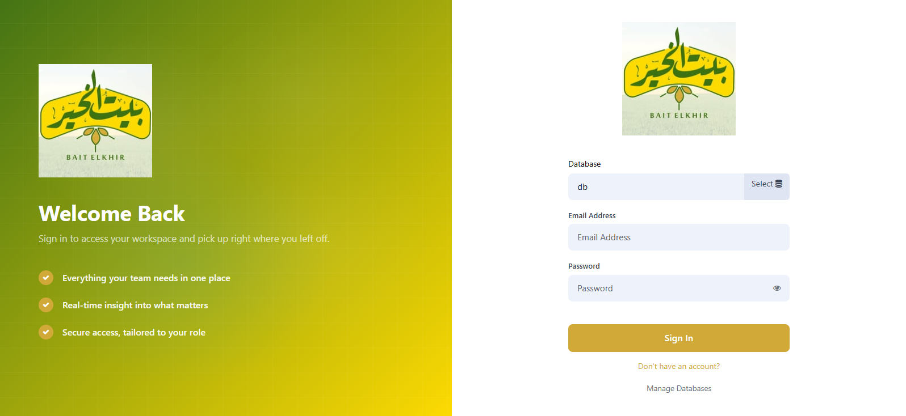
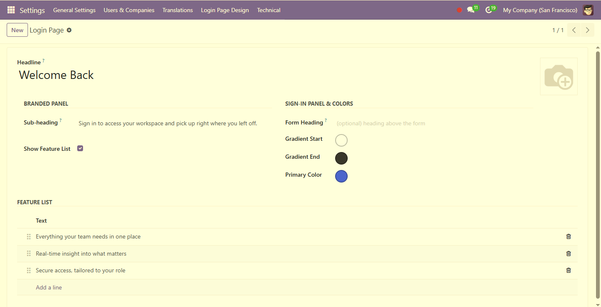

# Login Page Branding

A modern split-screen login page for **Odoo**, fully editable from the backend — no code changes needed to rebrand it.

**Available for both Odoo 18 and Odoo 19** — pick the folder that matches your version (see [Versions](#versions)).

## Preview

The new login page:

Everything on it is edited from *Settings > Login Page Design*:

## Features

- **Left panel:** logo, headline, sub-heading and a feature list on a gradient background.
- **Right panel:** the sign-in form, with a show/hide password toggle.
- **Everything is configurable** at *Settings > Login Page Design*: texts, logo, feature bullets and three colors.
- **Self-contained:** depends only on `web`. Drop it into any Odoo 18 or 19 database and install.
- **Safe by design:** colors are validated as hex codes, and the page reads its content through a single sudo-ed config record, so the public login screen never needs broader access.
- **Compatible with `website`:** the layout view is registered at a priority that always wins over the one `website` ships, so the design survives whether or not `website` is installed.

## Installation

1. Copy the folder for your Odoo version into your Odoo addons path, and rename it to `login_branding` (the technical name must be the same in both cases):
   - Odoo 18 → [`login_branding_odoo18/`](login_branding_odoo18)
   - Odoo 19 → [`login_branding_odoo19/`](login_branding_odoo19)
2. Restart Odoo and update the apps list (Apps > Update Apps List).
3. Install **Login Page Branding**.
4. Open *Settings > Login Page Design* (administrators only) and make it yours.

## Customizing

| Setting | What it does |
| --- | --- |
| Logo | Shown on both panels. Falls back to the bundled placeholder if empty. |
| Headline / Sub-heading | Text on the branded panel. Leave the sub-heading empty to hide it. |
| Feature list | Bullet points with a check icon. Drag to reorder, or switch the list off entirely. |
| Form heading | Optional title above the sign-in form. |
| Gradient start / end | Background gradient of the branded panel. |
| Primary color | Buttons, focus ring, links and bullet icons. |

The bundled logo and icon are neutral placeholders; replace `static/src/img/logo.png` and `static/description/icon.png` inside the module folder, or simply upload your own logo from the settings form.

The module also uses its logo as the browser-tab icon on all pages (`views/favicon_templates.xml`). Delete that file from the manifest's `data` list if you don't want that behavior.

## How it works

- A single `login.branding` record stores all the content; a `login.branding.feature` model holds the bullet list.
- `views/login_templates.xml` inherits `web.login_layout` and rebuilds it as two panels, reading the record with `sudo()` because the login page is served to the public user.
- Colors are injected as CSS variables (`--lb-navy`, `--lb-grad-end`, `--lb-blue`), so changing them needs no asset rebuild.
- The logo is served by Odoo's standard `/web/image` controller, so no custom route or proxy rule is needed.
- On small screens the branded panel is hidden and the form takes the full width.

## Versions

| Odoo version | Folder | Module version |
| --- | --- | --- |
| 18.0 | [`login_branding_odoo18/`](login_branding_odoo18) | `18.0.1.1.0` |
| 19.0 | [`login_branding_odoo19/`](login_branding_odoo19) | `19.0.1.1.0` |

Both versions look and behave the same. The only code difference is in the sign-in form template, because Odoo 19 restructured the stock login form. Use the folder that matches your Odoo version. Don't install both in the same addons path, since they share the technical name `login_branding`.

## Compatibility

Odoo 18.0 and Odoo 19.0 (Community and Enterprise).

## Contributing

Issues and pull requests are welcome. If you find a conflict with another login-related module, please include the module name and your Odoo version.

## License

LGPL-3
